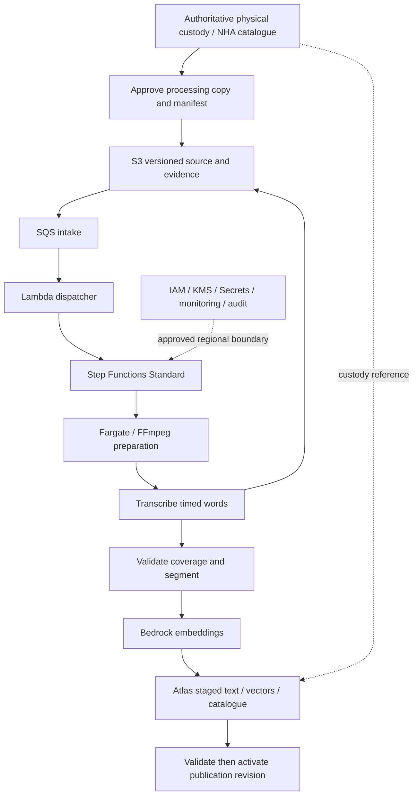
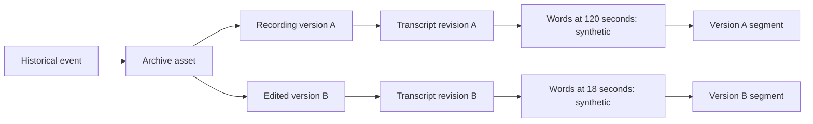
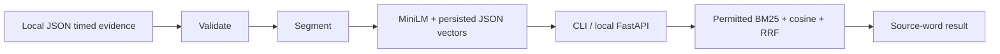

# Architecture diagrams

These diagrams describe the proposed production architecture unless labelled local. All AWS and Atlas services are proposed, not deployed.



```mermaid
sequenceDiagram
  actor U as Authorised producer
  participant API as API Gateway / Lambda
  participant ID as NHA IdP / current policy
  participant AT as Atlas Search + Vector Search
  participant R as RRF + word resolver
  participant AR as Archive operations
  U->>API: Imprecise description
  API->>ID: Authenticate and resolve current entitlements
  ID-->>API: Permitted discovery, snippets and actions
  API->>AT: Lexical + vector query with policy / publication filters
  AT-->>R: Permitted version-specific passages
  R->>R: Fuse ranks; suppress overlaps within each version
  R->>R: Exact words or broader validated interval
  R-->>API: Evidence and source interval
  API->>ID: Recheck permitted response/actions
  API-->>U: Excerpt, timing, version, quality, availability
  U->>API: Request authorised offline recording
  API->>AR: Reauthorised custody request (future integration)
```




